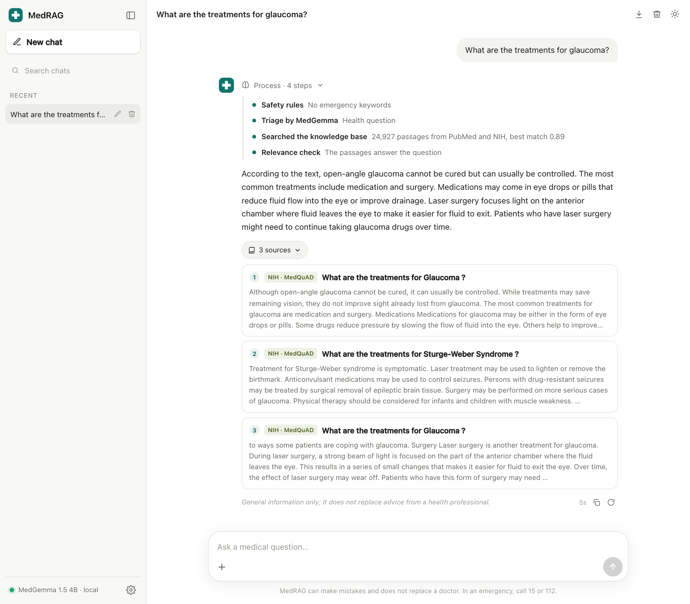
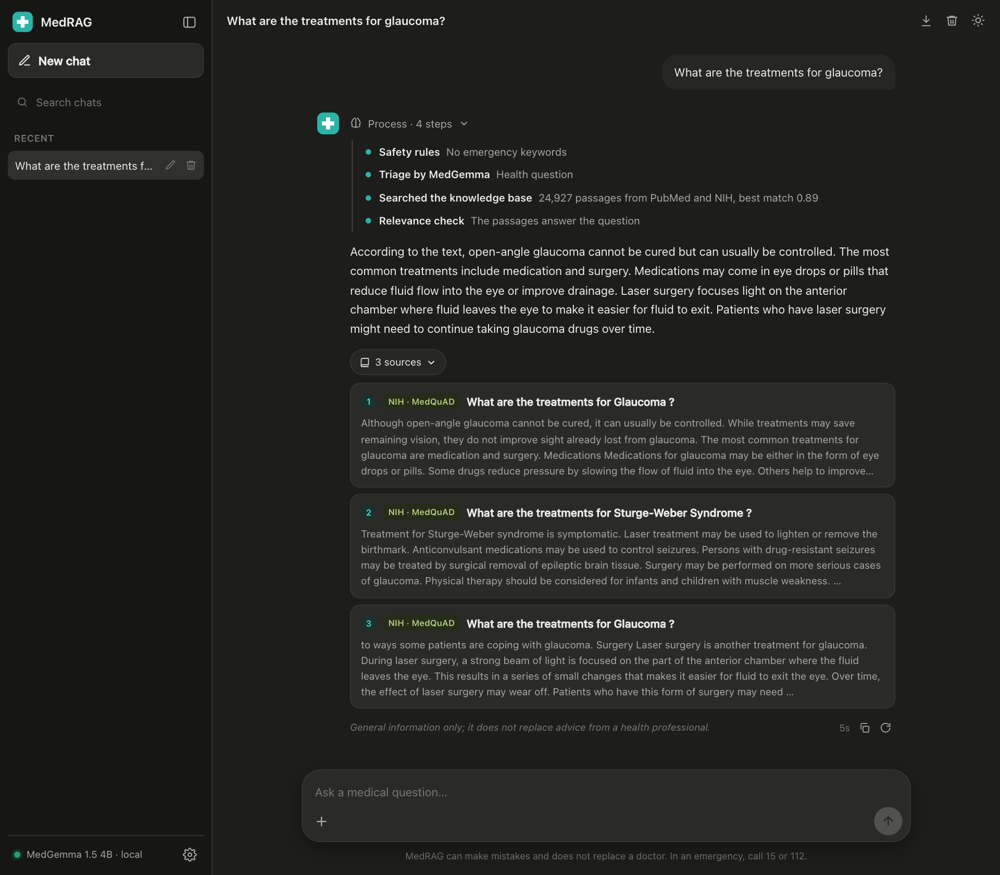
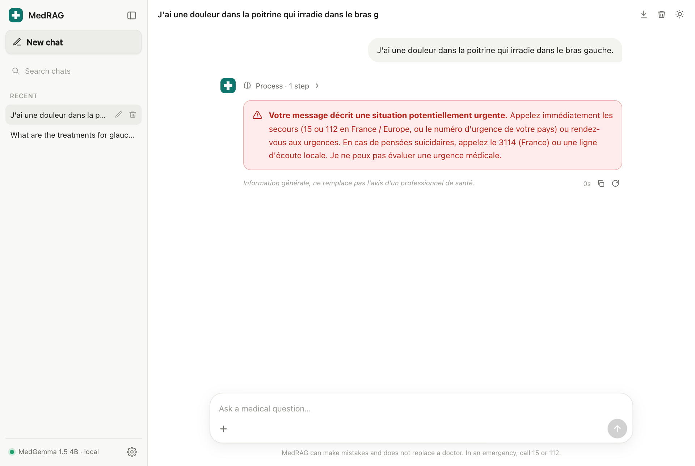
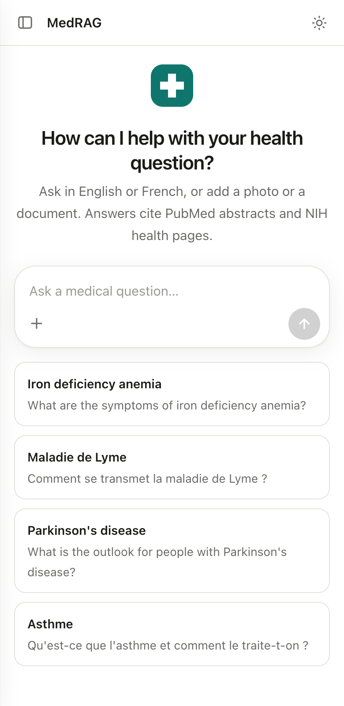
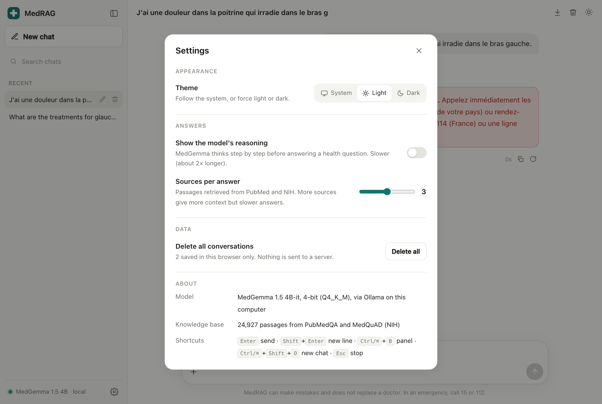

# AI Medical Chatbot using LLMs and RAG

A medical question-answering assistant that runs **100% locally** on a modest computer. It combines a small open-source medical LLM, **MedGemma 1.5 4B** quantized to 4 bits, with **retrieval-augmented generation (RAG)** over PubMed and NIH documents. Answers are grounded in cited sources, and safety guardrails handle emergencies, dosage requests and off-topic questions.

> ⚠️ This is an academic project. It gives general health information and **does not replace a health professional**. Do not use it for medical decisions.

## Key results

| Experiment | Result |
| --- | --- |
| Retrieval (E1) | Dense search wins: Recall@5 of **98.9%** (PubMedQA) and **93.3%** (MedQuAD) |
| Open answers (E3, MedQuAD) | RAG raises token F1 from **0.17 to 0.63** and grounding from **0.35 to 0.92**; 60% of answers cite a source |
| Safety guardrails (E4) | **96%** routing accuracy (23/24) with rules + LLM triage, vs 67% with rules + a similarity threshold |
| PubMedQA yes/no/maybe (E2) | About **54%** with or without RAG, below the 56.7% "always yes" baseline: the 4B model struggles to read scientific evidence |
| Resources (E5) | LLM uses **2.9 GB** of memory; the whole stack runs in under 4 GB |

Full analysis, failure cases and limitations are in the notebook (sections 7 to 9).

## How it works

```text
Offline:  PubMedQA + MedQuAD (4,000 docs) → 200-word chunks → multilingual-e5-small embeddings → FAISS index

Online:   user message
            → emergency keyword rules ─────────────► emergency message (no generation)
            → LLM triage: EMERGENCY / MEDICAL / OTHER
                 EMERGENCY ─────────────────────────► emergency message
                 OTHER ─────────────────────────────► out-of-scope reply
            → intent rules (dose / diagnosis request → caution note)
            → French question translated to English
            → dense search, top 3 passages
            → MedGemma 1.5 4B (Q4, Ollama) with a strict prompt
            → answer with [n] citations, in the user's language, plus a medical disclaimer
```

| Component | Choice |
| --- | --- |
| LLM | MedGemma 1.5 4B-it, GGUF Q4_K_M, served by [Ollama](https://ollama.com) |
| Embeddings | `intfloat/multilingual-e5-small` (118 M parameters) |
| Vector search | FAISS `IndexFlatIP` (BM25 and hybrid RRF also compared) |
| Data | [PubMedQA](https://huggingface.co/datasets/qiaojin/PubMedQA) (`pqa_labeled`) and [MedQuAD](https://huggingface.co/datasets/keivalya/MedQuad-MedicalQnADataset) |

## Repository

| File | Content |
| --- | --- |
| `Project_Report.pdf` | Full project report (19 pages): problem, state of the art, data, methodology, results, critical analysis, limitations, references |
| `medical_chatbot_rag.ipynb` | The whole project, executed with its results: introduction, state of the art, data, methodology, implementation, experiments, critical analysis, limitations, references |
| `requirements.txt` | Python dependencies |
| `methodologie.txt` | Outline of the report |

## Getting started

**1. Install Ollama and pull the model** (about 2.5 GB):

```bash
ollama pull hf.co/unsloth/medgemma-1.5-4b-it-GGUF:Q4_K_M
```

**2. Create a Python environment and install the dependencies** (tested with Python 3.14):

```bash
python3 -m venv ~/venvs/medical-chatbot
~/venvs/medical-chatbot/bin/pip install -r requirements.txt
~/venvs/medical-chatbot/bin/python -m ipykernel install --user --name medical-chatbot
```

> On macOS, keep the virtual environment **outside** iCloud-synced folders such as Desktop or Documents. iCloud can offload its files to the cloud, which makes imports extremely slow.

**3. Run the notebook** with the `medical-chatbot` kernel, Ollama running in the background. A full run takes about 1 hour on an Apple M4, mostly for the PubMedQA evaluation (450 LLM calls). The datasets and the embedding model download automatically on first run.

To try the chatbot only, run the cells up to section 5.6, build the retriever, then:

```python
medical_chatbot("Comment se transmet la maladie de Lyme ?", retriever, method="dense")
```

## Chat interface

MedRAG ships with a web app in the style of ChatGPT or Claude. Everything runs on your computer: the model, the search and your conversations.



| Dark theme | Emergency message | Mobile |
| --- | --- | --- |
|  |  |  |

### Features

| Area | What you can do |
| --- | --- |
| **Answers** | Answers stream word by word, in English or French, with clickable `[n]` citations that open the matching source (PubMed abstracts link to PubMed) |
| **Visible reasoning** | A **Process** panel shows each step: safety rules, triage, translation, search, relevance check. Turn on *Show the model's reasoning* in Settings to also see MedGemma think step by step before it answers |
| **Photos** | Add up to 3 images (button, drag and drop, or paste). MedGemma describes them through its vision encoder and never diagnoses |
| **Documents** | Add PDF, TXT or MD files. They are read and searched on the fly, and their passages are cited as "Your file" |
| **Conversation** | Greetings and simple general questions (for example "hello" or "2+2") get a short friendly reply; health questions go through RAG; emergencies are redirected to emergency services without any generated advice |
| **Chats** | History saved in your browser, search, rename, delete, export to Markdown, regenerate the last answer, stop an answer (Esc) |
| **Layout** | Collapsible side panel (Ctrl/Cmd+B), light, dark or system theme, mobile layout |
| **Settings** | Theme, model reasoning on or off, number of sources per answer (1 to 5), delete all conversations, keyboard shortcuts |



### Run it

Start everything with one command (Ollama, backend on port 8000, interface on port 5180):

```bash
./start.sh
```

Then open <http://localhost:5180>. The first start downloads the data and builds the index (about 4 minutes); it is then cached in `backend/cache/`.

| Folder | Content |
| --- | --- |
| `backend/` | FastAPI server (`app.py`) and the pipeline as a module (`rag.py`): rules and LLM triage, translation, dense search, relevance check, streaming, images and file reading |
| `frontend/` | React + Vite interface |
| `docs/screenshots/` | The images above |

### How the app differs from the evaluated notebook

The notebook measures one fixed configuration. The app changes four things for real use:

- it indexes **all 13,971 MedQuAD answers** (24,927 passages) instead of the 3,000-answer evaluation sample, so common topics such as Lyme disease are covered;
- it runs a **relevance check** before answering: if the retrieved passages do not answer the question, it says so instead of answering from the model's memory with misleading citations;
- the answer prompt asks for **3 to 5 sentences in the model's own words**, which reduced copying of passages and brought answers down to about 5 to 12 s on an Apple M4;
- triage has a **CHAT** class, so greetings and simple general questions are answered briefly instead of refused.

These changes were checked by hand on a few questions but are not part of the notebook's evaluation.

## Limitations

- English-only corpus; MedQuAD contains no drug leaflets, so the chatbot cannot answer reliably about medicines.
- Small evaluation samples, and no review by health professionals.
- The model sometimes merges passages, adds uncited claims or copies the context; one stroke warning case was missed by the guardrails.
- Latency was measured on an Apple M4 only (8 to 16 s per answer); it will be slower on a PC without a GPU.
- Image descriptions from a 4B model can be partly wrong; image analysis is experimental and never a diagnosis.
- Citations are often incomplete: the model sometimes cites only one passage for a whole answer.

## Roadmap

- [x] FastAPI backend with a streaming `/chat` route
- [x] React front end showing cited sources and the disclaimer
- [x] Photo and document upload, visible reasoning, themes and settings
- [ ] French and drug-information sources
- [ ] Recall-oriented emergency classifier
- [ ] Phase 2: QLoRA fine-tuning of the answer format (skeleton already in the notebook, section 9.3)
- [ ] Evaluation by health professionals

## Author

Wissem Sahli
